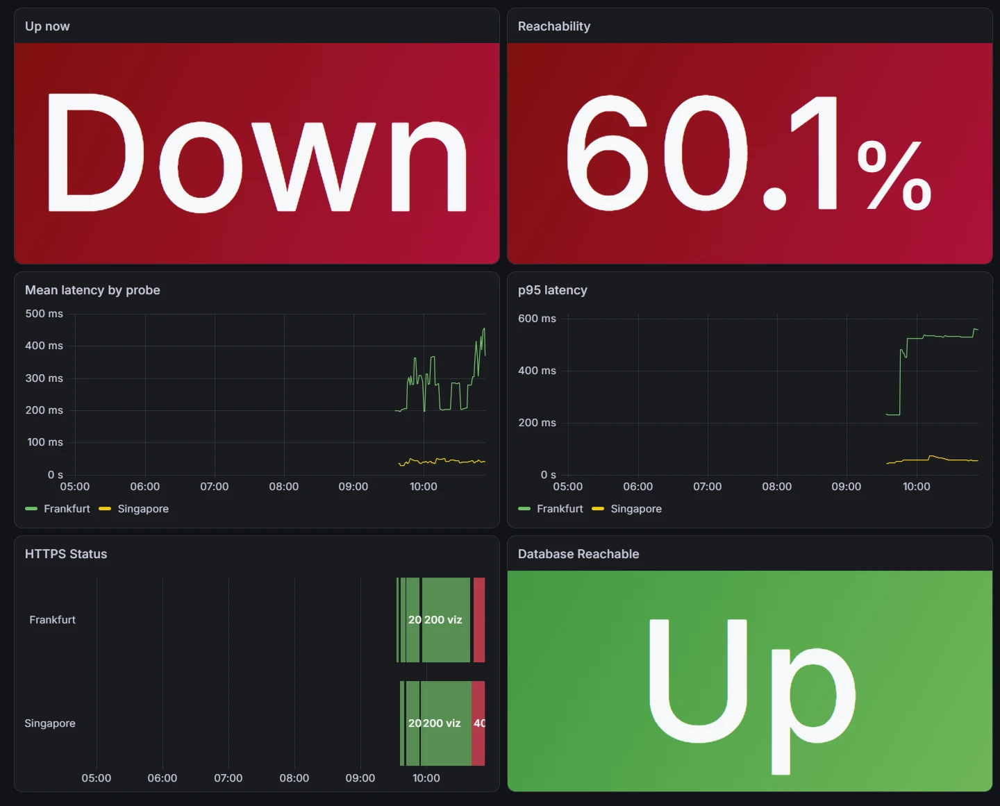
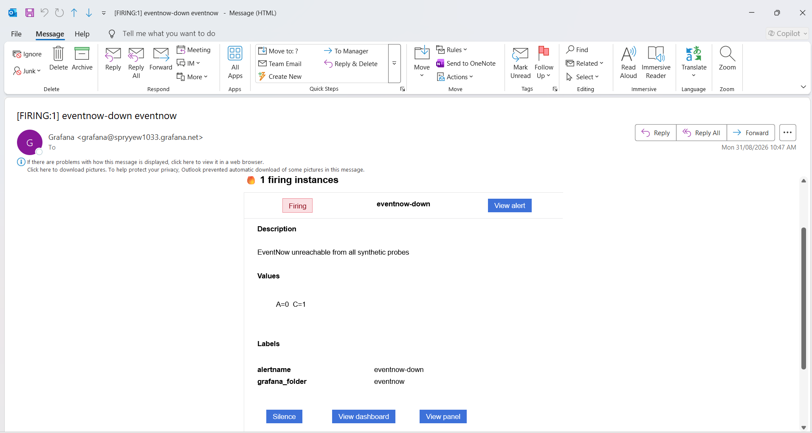
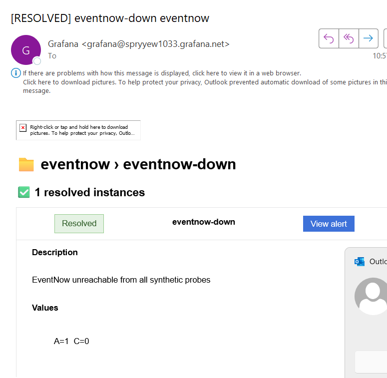
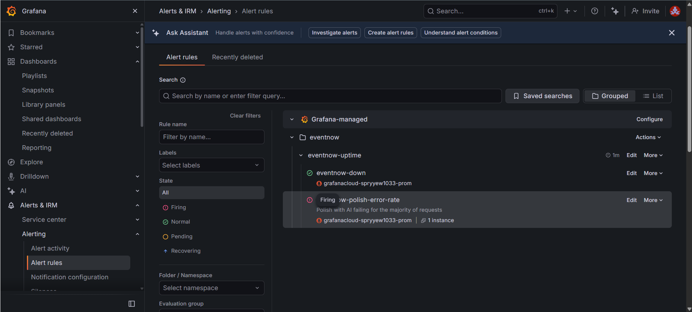
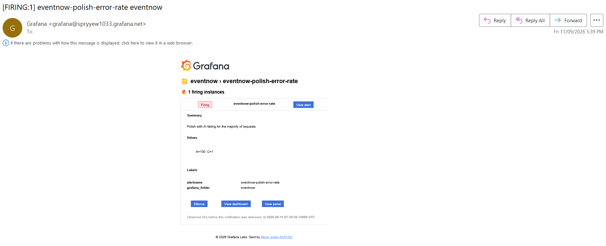
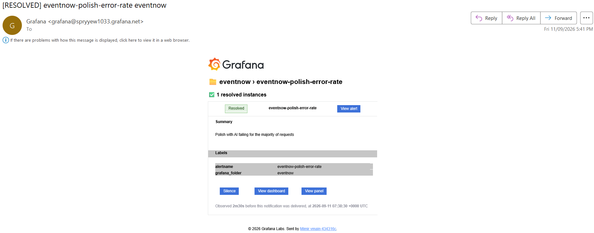
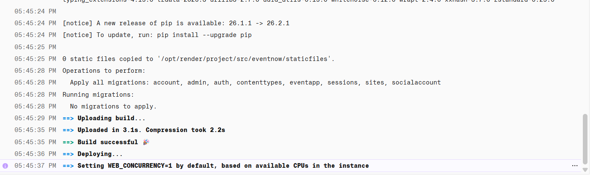

# EventNow monitoring

Observability for the live EventNow deployment, using Grafana Cloud's free tier.

## Why

On 26 August 2026, "Polish with AI" failed during a live demo. Groq had moved
`llama-3.3-70b-versatile` to their Enterprise tier and every developer key
started returning 404. The stack trace had been sitting in Render's logs for
hours; nobody was looking at Render's logs.

Nothing about that failure was hard to detect. It was only hard to *notice*.
This directory is the fix: an external monitor that watches the site from
outside, and — from V2 — the application reporting its own metrics.

## Architecture

```
                    (V1, outside-in)
  Grafana Cloud  ──── HTTPS probe ────►  /healthz/   liveness, no I/O
  Synthetic Mon. ──── HTTPS probe ────►  /readyz/    readiness, SELECT 1
         │
         ├── Prometheus (Mimir) ── dashboard: eventnow-overview
         └── Grafana Alerting ──── email

                    (V2, inside-out)
  Django + OpenTelemetry SDK ── OTLP/HTTP push ──► Grafana Cloud
     ├── auto-instrumented: RED metrics for every view
     └── hand-instrumented: polish_requests_total, polish_latency_seconds
```

No agent, no Prometheus server, no Kubernetes. Render's free tier gives one
process and no sidecars, so the app pushes OTLP straight to Grafana Cloud's
gateway rather than being scraped.

## Naming

Everything is prefixed `eventnow-` so the same Grafana stack can host the
follow-on ESP32 project (`sensor-*`) without collisions.

| Thing | Name |
|---|---|
| Grafana folder | `eventnow` |
| Dashboard | `eventnow-overview` |
| Synthetic check (liveness) | `eventnow-healthz` |
| Synthetic check (readiness) | `eventnow-readyz` |
| Alert rules | `eventnow-down`, `eventnow-polish-error-rate` |
| OTel service name | `eventnow` |

---

## The budget, which decides everything else

Two free tiers constrain the design, and the second one is the reason
`/healthz/` and `/readyz/` are separate endpoints.

### Grafana Cloud free tier

100,000 synthetic API test executions per month, 10,000 active metric series,
50 GB logs, 14-day retention, 3 seats. A month is ~43,200 minutes, so:

    executions/month = 43,200 / interval_minutes x probe_locations

| Check | Interval | Probes | Executions/month | % of 100k |
|---|---|---|---|---|
| `eventnow-healthz` | 2 min | 2 | 43,200 | 43% |
| `eventnow-readyz` | 30 min | 1 | 1,440 | 1% |
| **Total** | | | **44,640** | **45%** |

Leaves headroom for the sensor project later. One check at a 1-minute interval
from three probe locations would be 129,600 executions — over budget on its own.

### Neon free tier — the constraint that shaped the endpoints

100 CU-hours per month, and the compute suspends after ~5 minutes idle. So any
probe that runs a query more often than every 5 minutes holds Postgres awake
permanently:

    730 h/month x 0.25 CU (minimum size) = 182 CU-hours

Nearly double the entire monthly allowance, spent on health checks. That is why
liveness touches no database at all. Readiness does, at a 30-minute interval:

    duty cycle = 5 min awake / 30 min = 17%
    730 h x 0.17 x 0.25 CU = ~30 CU-hours/month   (30% of budget)

leaving ~70 CU-hours for actual visitors and interview demos. The cost is
detection latency: a database outage takes up to 30 minutes to show up. For a
portfolio site that is the right trade. Tighten the interval only while watching
the Neon console's usage graph.

*These figures are estimates from published limits (August 2026). Verify the
minimum compute size for your Neon project in the console — if it is above
0.25 CU the readiness interval needs to grow accordingly.*

### Render free tier

Free web services spin down after 15 minutes of inactivity. A 2-minute liveness
probe keeps the service warm, which made the old cron-job.org keep-alive ping
redundant — retired 31 Aug 2026, once V1 was live.

Worth naming the smell: the monitor then becomes load-bearing. If Grafana's
synthetic monitoring has an outage, EventNow cold-starts. Acceptable here, and
exactly the kind of coupling to avoid in a system that matters.

---

## The endpoints

Implemented in [`eventnow/eventapp/health.py`](../eventnow/eventapp/health.py),
tested in `HealthEndpointTests`. The naming follows the Kubernetes convention
(`healthz` / `readyz`) rather than a single `/health/`, because the
liveness-vs-readiness distinction is exactly what the Neon budget forces, and
because it is the vocabulary any orchestrator uses.

```
GET /healthz/     liveness — process up, credentials present. Zero queries.
GET /readyz/      readiness — the above plus SELECT 1 against Postgres.
```

Both return the same envelope:

```json
{
  "status": "ok",
  "checks": { "db": "ok", "llm_config": "ok" },
  "version": "1743d71",
  "llm_model": "openai/gpt-oss-20b"
}
```

Three response states, deliberately mapped to two HTTP codes:

| `status` | HTTP | Meaning | Should it page you? |
|---|---|---|---|
| `ok` | 200 | Everything checked is fine | no |
| `degraded` | 200 | Misconfigured — e.g. `LLM_API_KEY` unset | not by status code |
| `error` | 503 | A hard dependency is unreachable | yes |

`degraded` returns 200 on purpose. The site serves perfectly well with the AI
button broken, and a missing API key should not fire the same alarm as the
database being gone. The monitor catches degraded states with a **body
assertion** on `"status": "ok"` instead — a second, quieter signal on the same
probe. Separating "is it up" from "is it fully healthy" is the whole reason the
Groq outage was invisible: by any uptime check that existed at the time, the
site was up.

Two things the endpoints deliberately do *not* do:

- **No real LLM call.** It would cost money on every probe and burn the
  provider's rate limit. The config check asserts the key is present and reports
  which model the app would ask for — the two facts that actually mattered in
  August.
- **No exception messages in the response.** Driver errors embed the database
  host and sometimes credentials, and this endpoint is public. Only the
  exception class name gets out (`error: OperationalError`).

Verify locally:

```bash
curl -s localhost:8000/healthz/
```

---

## Evening 1 — build it

Click through these yourself; the point is to learn the UI, not to read about it.

1. **Sign up** at grafana.com for a free Cloud stack. Note the stack region —
   it appears in the OTLP endpoint URL you will need in V2.

2. **Create the folder** `eventnow` under Dashboards, so nothing lands loose in
   the General folder.

3. **Create check `eventnow-healthz`** — Testing & synthetics → Synthetic
   Monitoring → Checks → Add HTTP check.
   - Job name: `eventnow-healthz`
   - Target: `https://eventnow-kq6z.onrender.com/healthz/`
     (**https**, not http — the app sets `SECURE_SSL_REDIRECT`, so an http
     target measures a redirect rather than the endpoint)
   - Frequency: 2 minutes
   - Probes: two locations, e.g. Singapore (nearest the Render region) and
     Frankfurt. Two probes let you tell "the site is down" from "one probe's
     network is having a moment".
   - Under validation, add a body assertion: response body **contains**
     `"status": "ok"`. This is what would have caught the Groq outage.

4. **Create check `eventnow-readyz`** — same shape, target `/readyz/`,
   frequency **30 minutes**, one probe. Re-read the Neon arithmetic above before
   you are tempted to set this to 1 minute.

5. **Build the dashboard** `eventnow-overview` in the `eventnow` folder, with
   the panels below. Type the queries by hand rather than pasting — PromQL is
   muscle memory.

6. **Add the alert**, then **run the fire drill**. Screenshot for the README.

### The panels

Datasource: the Prometheus one, named something like
`grafanacloud-<yourstack>-prom`.

**1. Up right now** — Stat panel

```promql
max(probe_success{job="eventnow-healthz"})
```

`probe_success` is 1 or 0, one series per probe location. `max` over them means
"at least one probe can reach the site". Set the panel's value mappings so 1
renders as "Up" (green) and 0 as "Down" (red).

**2. Reachability over the selected range** — Stat panel, unit percent (0-100)

```promql
100 * sum(delta(probe_all_success_sum{job="eventnow-healthz"}[$__range]))
    / sum(delta(probe_all_success_count{job="eventnow-healthz"}[$__range]))
```

`probe_all_success_sum` / `_count` are running counters kept inside the probe
agent: successes so far, and executions so far. `delta()` gives how much each
grew across the window, so the ratio is the success rate over that window.
`$__range` is Grafana's variable for the dashboard's current time picker — the
number re-computes when you zoom.

Counters rather than the `probe_success` gauge, because a counter survives a
gap: if the probe ran but could not ship its sample, the count catches up when
reporting resumes.

**3. Mean latency by probe** — Time series, unit seconds

```promql
  sum by (probe) (rate(probe_all_duration_seconds_sum{job="eventnow-healthz"}[10m]))
/ sum by (probe) (rate(probe_all_duration_seconds_count{job="eventnow-healthz"}[10m]))
```

The `_sum` / `_count` pair is a Prometheus *summary*: total seconds observed,
and number of observations. Dividing the two rates gives the mean over the
window.

`rate()` is the single most important PromQL function. Counters only ever go up,
and reset to zero when a process restarts; `rate(x[10m])` gives the per-second
increase over the last 10 minutes and handles the resets for you. Never graph a
raw counter — graph its `rate()`.

Pick a window at least 4x the scrape interval or you get gaps. At a 2-minute
check frequency, `[10m]` is comfortable.

**4. p95 latency** — Time series, unit seconds

```promql
quantile_over_time(0.95, probe_duration_seconds{job="eventnow-healthz"}[1h])
```

Note this is **not** `histogram_quantile()`. That function needs a histogram — a
metric split into `_bucket` series carrying `le` labels. Synthetic monitoring
does not publish one; `probe_duration_seconds` is a plain gauge, one value per
execution. `quantile_over_time()` computes the quantile across the raw samples
in the window instead.

V2 gives you the other case: OpenTelemetry's HTTP duration metric *is* a
histogram, and there the query is

```promql
histogram_quantile(0.95, sum by (le) (rate(http_server_request_duration_seconds_bucket[5m])))
```

Same question, different data shape. Knowing which one applies is most of what
"knows PromQL" means in practice.

**5. HTTP status code** — State timeline

```promql
probe_http_status_code{job="eventnow-healthz"}
```

Makes a 503 from `/readyz/` visually distinct from a connection timeout, which
produces no status code at all.

**6. Database reachable** — Stat, from the readiness check

```promql
max(probe_success{job="eventnow-readyz"})
```

### The alert

Alerting → Alert rules → New alert rule.

- Name: `eventnow-down`
- Query A:

  ```promql
  max(probe_success{job="eventnow-healthz"})
  ```

- Reduce: Last. Threshold: **IS BELOW 1**.
- Evaluation interval: 1 minute. **Pending period: 5 minutes.**
- Folder `eventnow`, evaluation group `eventnow-uptime`.
- Contact point: email.

The pending period is the part worth understanding. Without it a single failed
probe fires the alert, and you learn to ignore your own alerts within a week.
Five minutes at a 2-minute check frequency means roughly two or three
consecutive failures before anything reaches your inbox.

`max` rather than `min` is the other deliberate choice: `min` would fire when
*any* probe fails, which is mostly a report on the internet's weather. `max`
below 1 means *every* probe failed — that one is about you.

### The fire drill

An alert you have never seen fire is a hypothesis, not a safety net.

**Safe version, do this one first.** Edit the `eventnow-healthz` check's target
to a path that does not exist — `/healthz-firedrill/` — and save. Django returns
404, `probe_success` drops to 0. Expect the email in 5-8 minutes. Revert the
target and confirm the resolved notification arrives too.

**Honest version, optional.** Suspend the Render service from its dashboard and
watch the whole chain break the way it would in reality. Only worth doing when
no interview is imminent.

Screenshot the firing alert and the dashboard mid-outage. Those two images are
the README's evidence that this works.

### Fire drill evidence (run 31 Aug 2026)

The check target was pointed at a non-existent path; the alert went
Pending after the first failed probes and Firing once the 5-minute pending
period elapsed, roughly eight minutes after the edit.

The dashboard mid-outage — site down, database still fine. The two failure
domains separate exactly as designed, and the HTTPS Status panel shows the
404 band: a server answering with the wrong answer, not silence.



The alert email, and the resolved notification after the target was reverted:





One unplanned finding from the drill era: the first thing this monitoring
setup ever alerted on was itself. The body assertion was saved with inverted
polarity — *fail if the body matches* — so every healthy probe failed the
check while the site was fine. The execution log stated it plainly
(`level=ERROR msg="Body matched regular expression"`), and the same
polarity mistake surfaced a second time in the alert rule's condition
(`IS ABOVE 0` on a metric that is 1 when healthy), caught by previewing the
rule before saving. Both are now part of the checklist: read the assertion
semantics, and never save an alert without previewing its current state.

---

## Evening 2 — inside-out (completed 11 Sep 2026)

The app now reports its own metrics. Definition of done was a Polish click on
the live site visible on the dashboard within about a minute — met, and then
some: the re-enactment below shows the original incident being detected in
real time.

### What was built

- **`eventnow/eventnow/telemetry.py`** — env-gated OpenTelemetry setup,
  called from `wsgi.py` before the WSGI handler is built (the Django
  auto-instrumentation inserts its middleware into `settings.MIDDLEWARE`, so
  it must run first). With no `OTEL_EXPORTER_OTLP_ENDPOINT` set the module
  does nothing: local dev needs no Grafana account, and telemetry failures
  cost data, never uptime — verified by running the app against a
  black-holed exporter.
- **Push, not pull.** Metrics aggregate in-process and are POSTed to Grafana
  Cloud's OTLP gateway every 60 s. Render's free tier gives one dyno and no
  sidecars — there is nothing for a Prometheus server to scrape, so the app
  pushes. The trade: with pull, the scraper notices when you stop answering;
  with push, silence is ambiguous. The V1 synthetic probes cover exactly
  that blind spot, which is why both halves exist.
- **RED metrics auto-instrumented** for every view via
  `opentelemetry-instrumentation-django`, with the probes excluded
  (`OTEL_PYTHON_DJANGO_EXCLUDED_URLS=healthz,readyz`, defaulted in code) so
  the 2-minute liveness check does not become the majority of "traffic".
- **Hand-instrumented `ai.py`**: `polish_requests` counter (labels
  `outcome` and `error_type` — the exception class name, a bounded set;
  labels must never carry user data or raw messages, every combination is a
  billable time series) and `polish_latency` histogram with LLM-scale
  buckets (0.25–30 s; the SDK defaults are millisecond-tuned and would dump
  every sample into one bucket). The OTLP-to-Prometheus translation appends
  the suffixes: they land as `polish_requests_total` and
  `polish_latency_seconds_*`.
- One stroke of luck verified from the deploy log: Render sets
  `WEB_CONCURRENCY=1`, so gunicorn runs a single worker and the
  multi-process metric-collision problem does not exist here. First question
  to ask when this pattern meets a real multi-worker deployment.

### The dashboard rows

**RED — application** (all with `job="eventnow"`):

```promql
# Request rate, per route
sum by (http_route) (rate(http_server_request_duration_seconds_count{job="eventnow"}[5m]))

# Error rate (5xx only — a 404 is a bored visitor, not a broken app)
100 * sum(rate(http_server_request_duration_seconds_count{job="eventnow", http_response_status_code=~"5.."}[5m]))
    / sum(rate(http_server_request_duration_seconds_count{job="eventnow"}[5m]))

# p95 duration — histogram_quantile on a real histogram this time
histogram_quantile(0.95, sum by (le) (rate(http_server_request_duration_seconds_bucket{job="eventnow"}[5m])))
```

**Polish with AI**:

```promql
# Calls by outcome (increase, not rate — polish clicks are rare events)
sum by (outcome, error_type) (increase(polish_requests_total[1h]))

# Error ratio
100 * sum(rate(polish_requests_total{outcome="error"}[10m]))
    / sum(rate(polish_requests_total[10m]))

# p95 latency of successful polishes
histogram_quantile(0.95, sum by (le) (rate(polish_latency_seconds_bucket[10m])))
```

### Alert: `eventnow-polish-error-rate`

Error ratio above 50%, evaluated every minute, pending period 10 minutes —
single failures are weather; a sustained majority failing is the August
signature. One setting V1 did not need: **"if no data → Normal"**. The
ratio is 0/0 whenever nobody has clicked Polish for 10 minutes, which on a
portfolio site is most of the time, and the default would page about an
idle feature. (The setting was configured, saved, and then found still at
its default on the rule's detail page — the third "verify the applied
state, not the saved form" incident of this project.)

### The re-enactment (11 Sep 2026)

The point of the whole project, performed deliberately: `LLM_MODEL` was set
back to `llama-3.3-70b-versatile` — the model whose retirement caused the
original incident — and Polish was clicked a few times on the live site.

Within one export interval the dashboard showed
`error_type="NotFoundError"` climbing and the error ratio at 100%. The rule
went Pending at 17:28, Firing at 17:38:30, email at 17:39:





**The most important panel during the outage was the one that stayed
empty.** The HTTP error-rate panel showed "No data" throughout, because the
view catches the LLM exception and returns a friendly 200 — at the HTTP
layer nothing was failing. That is precisely why the real August incident
was invisible to any status-code-based check, and why the two
hand-instrumented metrics exist: auto-instrumentation gives breadth, but
only code that knows what "broken" means for a feature can report it.

### Why the alert resolved before the fix deployed

The resolved email arrived at 17:41 — but the revert build only went live
at ~17:46 (deploy log below). The alert did not resolve because Polish
recovered; it resolved because the *evidence expired*:





The error clicks happened around 17:25–17:28 and then stopped. The
condition is a ratio over a trailing `[10m]` window, and the pending period
is also 10 minutes — so the rule fired at the exact moment the errors began
ageing out of the window, and resolved one evaluation later when the window
forgot them. A burst that ends produces fire-then-instant-resolve whenever
pending period ≈ rate window.

Two operational lessons out of that:

- **A drill's traffic shape differs from a real outage's.** Real users keep
  clicking, every failure refreshes the window, and the alert stays firing.
  A burst followed by silence looks, to a trailing-window ratio, like
  recovery. Ratio alerts monitor failing *activity*, not broken *state*.
- **A resolved notification means "the condition stopped being true", not
  "the problem is fixed".** Here the fix arrived five minutes after the
  resolution it did not cause.

### Budget check

Active series after V2: a few hundred of the 10k free — RED histogram
buckets × routes × methods, plus a handful of polish series. Comfortable,
with room for the `sensor-*` project.
